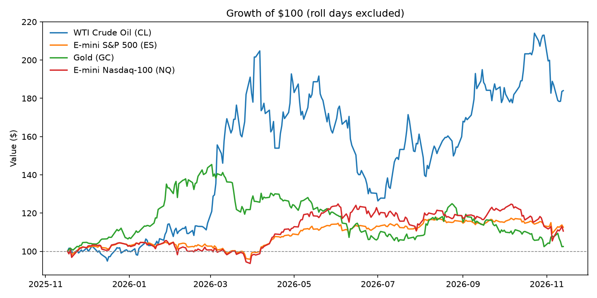
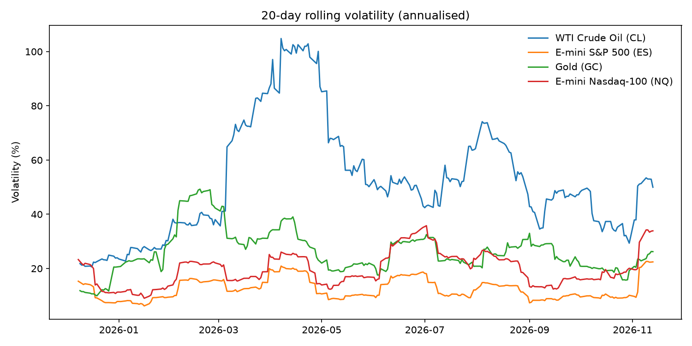
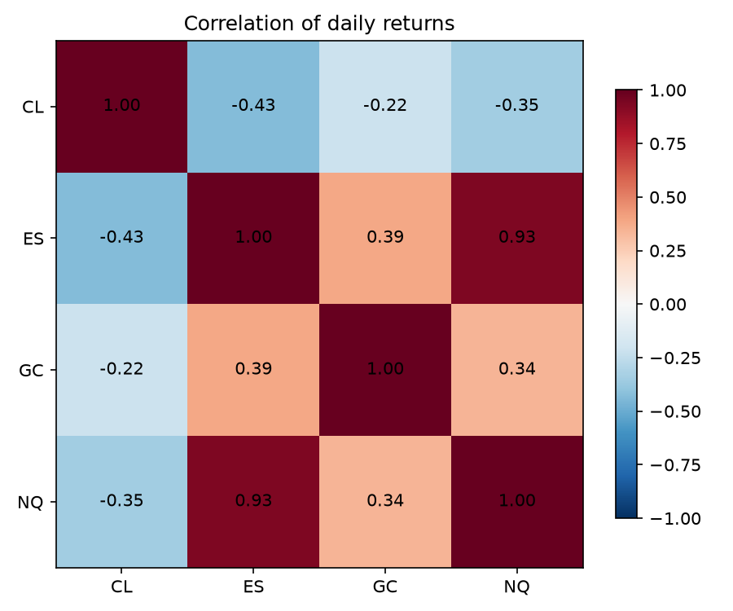
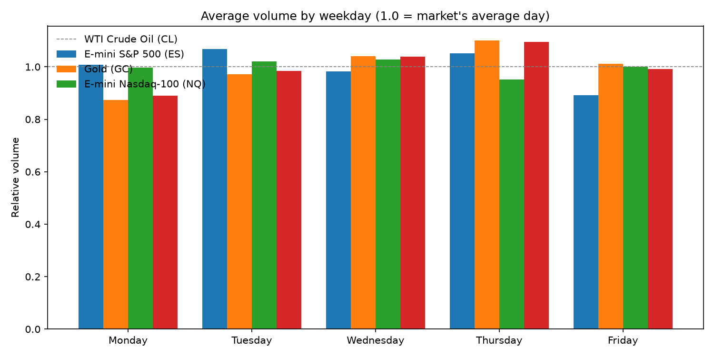

# Futures Market Analysis with the Databento API

Pulls a year of daily market data for four major CME futures from the [Databento](https://databento.com) Historical API, then compares how they performed, how volatile they were, how they moved together, and when they traded most.

| Symbol | Market |
|---|---|
| `ES.v.0` | E-mini S&P 500 |
| `NQ.v.0` | E-mini Nasdaq-100 |
| `CL.v.0` | WTI Crude Oil |
| `GC.v.0` | Gold |

The project is written as a beginner-friendly walkthrough. Each step explains *why* it's done, and the [Troubleshooting](#troubleshooting) section covers the problems new users of the API are most likely to hit.



## Results

Data: Databento `GLBX.MDP3`, `ohlcv-1d`, 2025-11-17 to 2026-11-13 (260 trading days).

| Market | Total return | Annualised volatility | Max drawdown | Best day | Worst day | Avg daily volume | Contract rolls |
|---|---|---|---|---|---|---|---|
| WTI Crude Oil (CL) | +84.0% | 55.4% | -38.3% | +14.92% (2026-03-06) | -15.27% (2026-04-07) | 194,282 | 12 |
| E-mini S&P 500 (ES) | +12.6% | 13.8% | -8.5% | +3.40% (2026-03-31) | -4.85% (2026-11-05) | 1,389,344 | 4 |
| Gold (GC) | +2.5% | 27.5% | -29.6% | +6.41% (2026-01-28) | -6.19% (2026-02-05) | 140,282 | 5 |
| E-mini Nasdaq-100 (NQ) | +10.6% | 21.8% | -15.5% | +4.30% (2026-03-31) | -6.69% (2026-11-05) | 541,134 | 4 |

- Most correlated pair: **ES / NQ** (0.93)
- Least correlated pair: **CL / ES** (-0.43)
- Busiest weekday overall: **Thursday**; quietest: **Monday**

**What stood out**

- **Crude oil was the story of the year.** It returned +84% with four times the volatility of the S&P 500. Its best and worst days line up with real events: +14.9% on March 6, 2026, when shipping through the Strait of Hormuz stopped, and −15.3% on April 7, when a two-week ceasefire was announced. Seeing those headlines show up in the raw data was a nice check that the pipeline works.
- **Oil and stocks moved in opposite directions** (correlation −0.43). When oil spiked on supply fears, equity index futures tended to fall.
- **The S&P 500 and Nasdaq-100 moved almost as one** (0.93), down to sharing the same best day (March 31) and worst day (November 5).
- **Gold went nowhere but took a bumpy route:** +2.5% for the year, with 27.5% volatility and a −29.6% drawdown along the way.
- **The roll counts match each market's contract calendar:** crude lists a contract every month (12 rolls), while the stock index futures roll quarterly (4).

| Volatility | Correlation |
|---|---|
|  |  |



## How it works

### 1. Check the cost before downloading (`fetch.py`)
Databento charges per gigabyte of data. Before downloading anything, the script calls `metadata.get_cost`, which is free, and stops if the estimate is above a safety limit ($1.00 by default). A year of daily bars for four markets costs only a few cents, which the $125 sign-up credit covers.

```python
cost = client.metadata.get_cost(
    dataset="GLBX.MDP3",       # CME Globex
    symbols=["ES.v.0", "NQ.v.0", "CL.v.0", "GC.v.0"],
    stype_in="continuous",     # .v.0 = most-traded contract, rolled automatically
    schema="ohlcv-1d",         # one open/high/low/close/volume bar per day
    start="2025-11-14",
    end="2026-11-14",
)
```

### 2. Download once, then reuse
`timeseries.get_range` downloads the data. The script saves it twice:
- as **DBN** (`.dbn.zst`), Databento's compact binary format, and
- as **CSV** for the analysis.

Re-running the analysis reads the saved file, so you never pay for the same data twice.

### 3. Choose the right roll rule
Each futures market has several contract months trading at once, and a continuous symbol has to pick one. Databento offers three roll rules:
- `.c.` (calendar): the nearest expiry
- `.n.` (open interest): the contract with the most open positions
- `.v.` (volume): the contract that traded the most the previous day

My first run used the calendar rule (`GC.c.0`). Gold showed an average volume of just **221 contracts a day**. Gold's nearest expiry is often a thin, rarely traded month while the real trading happens in a later one, so its prices were unreliable. Switching to the volume rule (`.v.0`) follows where the market actually trades.

### 4. Drop the Sunday bars
Daily bars are cut at midnight UTC. CME Globex reopens on Sunday evening (US time), which is still Sunday in UTC, so every week starts with a short, thin "Sunday" bar. My first run counted these as full trading days: **313 "trading days"** in a year instead of about 252, and fake one-day moves like crude oil's +18% on a Sunday followed by −18% on Monday. The analysis now drops weekend bars; Monday's bar covers that trading.

### 5. Handle contract rolls (`analyze.py`)
A futures contract expires, so `ES.v.0` switches to the next contract as trading moves over. On that day the `instrument_id` changes and the price can jump because the two contracts trade at different levels. That jump isn't a real market move, so the analysis **excludes returns on roll days** instead of letting them distort the volatility and drawdown figures.

### 6. Analyse and chart
For each market: total return, annualised volatility, maximum drawdown, best and worst day, average volume and number of rolls. The script also produces four charts and a correlation matrix.

## Quickstart

**Requirements:** Python 3.10+ and a free [Databento account](https://databento.com/signup). A card is needed to sign up, but nothing is charged while you stay within the free credits.

```bash
git clone https://github.com/Christos005/databento-futures-analysis.git
cd databento-futures-analysis
python -m venv .venv
source .venv/bin/activate          # Windows: .venv\Scripts\activate
pip install -r requirements.txt

cp .env.example .env               # Windows: copy .env.example .env
# open .env and paste your API key after DATABENTO_API_KEY=

python fetch.py                    # shows the cost and asks before downloading
python analyze.py                  # writes charts/ and results/summary.md
```

Options:

```bash
python fetch.py --start 2025-01-01 --end 2026-01-01   # custom dates (end is exclusive)
python fetch.py --symbols ES.v.0 GC.v.0                # fewer markets
python fetch.py --max-cost 0.25                        # stricter cost limit
```

## Troubleshooting

| Problem | Likely cause | Fix |
|---|---|---|
| `No API key found` | `.env` is missing or the variable name is wrong | Copy `.env.example` to `.env` and check the line reads `DATABENTO_API_KEY=db-...` with no quotes or spaces |
| `401` / authentication error | Key is incomplete, has extra spaces, or was deleted in the portal | Copy the key again from the portal's API keys page. Keys are 32 characters and start with `db-` |
| Error mentioning the end date or available range | `--end` is later than the latest data Databento has published | Use an earlier `--end` date, e.g. yesterday or the last weekday |
| `422` or "symbol" error | Symbol doesn't match `stype_in` | Continuous symbols look like `ES.v.0`. A specific contract like `ESZ6` needs `stype_in="raw_symbol"` |
| Request returns no rows | Dates cover only weekends or holidays, or the symbol doesn't exist in that dataset | Widen the date range, and check the symbol trades on CME Globex (`GLBX.MDP3`) |
| `Stopped: cost is above the --max-cost limit` | Too many symbols, too long a range, or a heavier schema | Narrow the request, or raise `--max-cost` if you're sure |
| Price jumps on certain days | Contract roll in a continuous symbol | Expected. The analysis excludes roll days; see "Handle contract rolls" above |
| Very low volume for a market (e.g. gold at a few hundred contracts a day) | The calendar roll rule (`.c.0`) picked a thin contract month | Use the volume rule (`.v.0`) or open-interest rule (`.n.0`) to follow the liquid contract |
| `BentoWarning: ... reduced quality: 2025-11-28 (degraded) ...` | Databento's dataset-condition metadata marks some days in the range as reduced quality | Not an error: the data still downloads. Check which days are affected with `client.metadata.get_dataset_condition(...)` and decide whether they matter for your analysis |
| More than ~252 trading days a year, or big moves dated on a Sunday | `ohlcv-1d` bars are cut at midnight UTC, so Globex's Sunday-evening reopen creates a short Sunday bar | Drop weekend bars (as `analyze.py` does), or build your own daily bars from `ohlcv-1h` using exchange session times |
| `ModuleNotFoundError: databento` | Dependencies not installed in the active environment | Activate `.venv` and run `pip install -r requirements.txt` |

## Project structure

```
fetch.py            download data (cost check → download → save)
analyze.py          metrics, charts and summary
requirements.txt    Python dependencies
.env.example        template for your API key (copy to .env)
charts/             generated charts
results/summary.md  generated results table
data/               downloaded data (git-ignored)
```

## Notes

- Your API key lives only in `.env`, which `.gitignore` keeps out of GitHub.
- Downloaded market data is git-ignored too. It's licensed by Databento and anyone can re-download it with their own key.

---
**Author:** Christos Georgoudis · [GitHub](https://github.com/Christos005)
